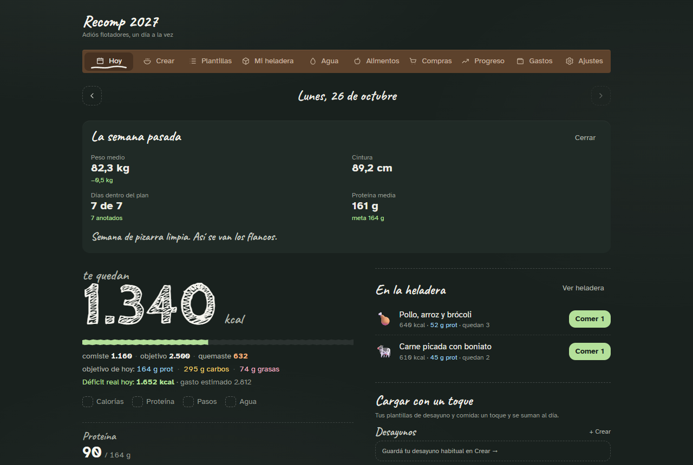
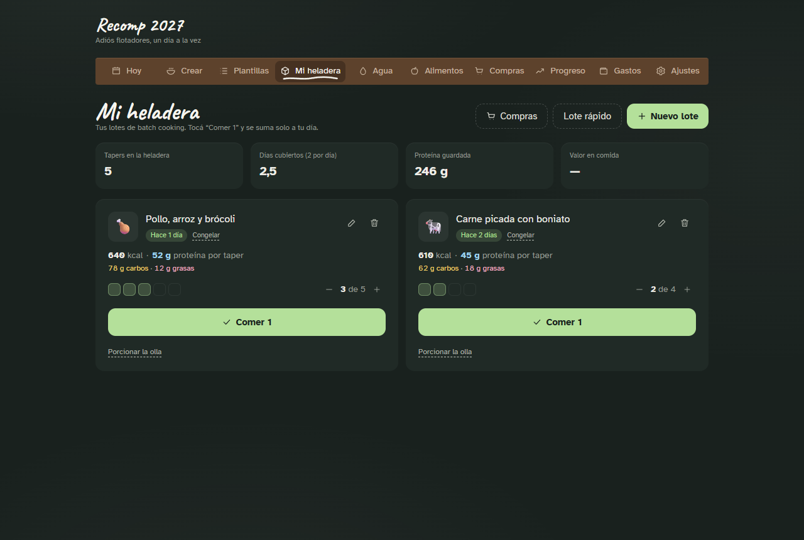
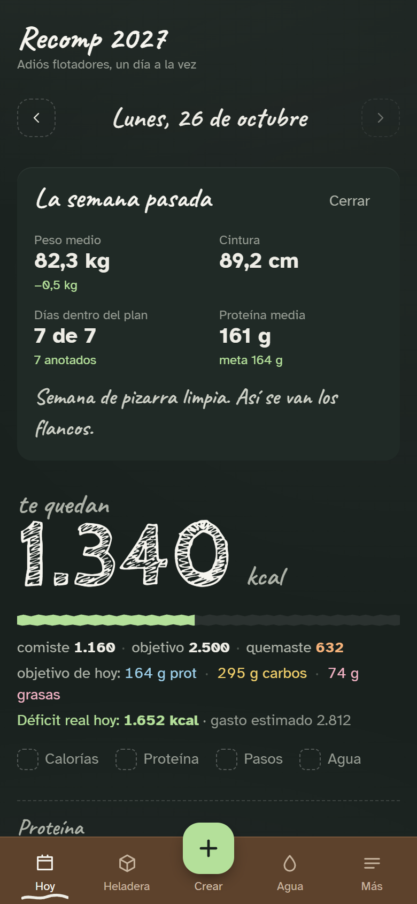
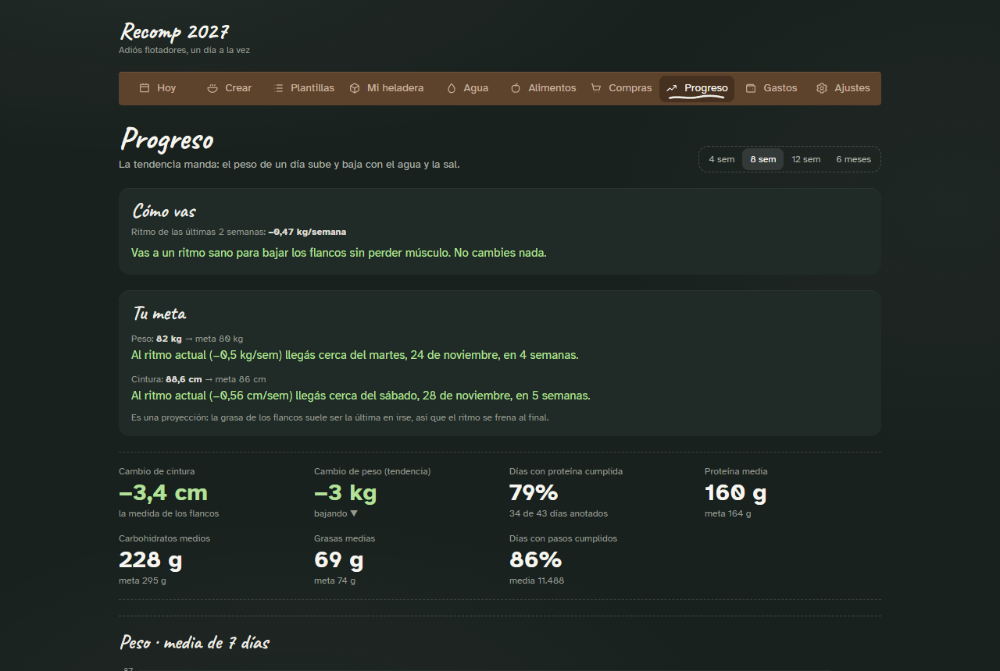
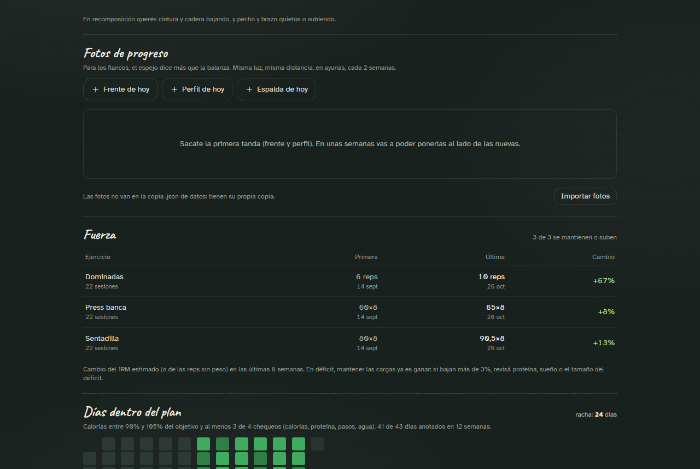
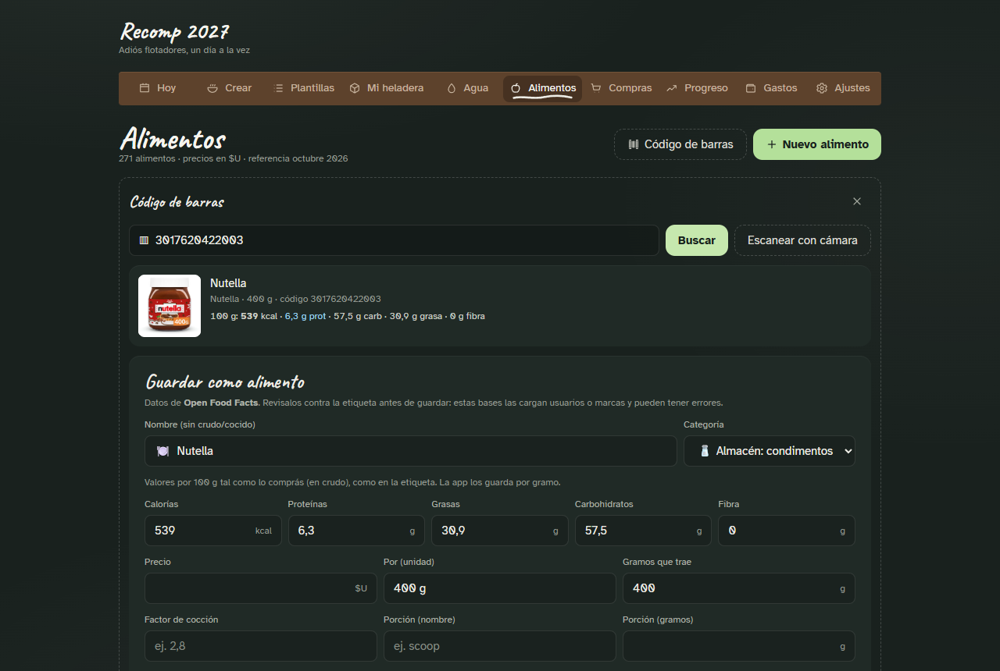

# Recomp 2027

> Una app web personal para sostener un plan de recomposición corporal: comer en déficit con proteína alta, caminar, entrenar fuerza y ver el progreso real, semana a semana.



Recomp 2027 nació de una necesidad concreta: bajar la grasa localizada de los flancos sin perder músculo. Las apps genéricas de calorías no encajaban con la forma real de comer de su autor (cocinar una vez por semana, comer tapers, comprar en ferias y supermercados de Uruguay), así que se construyó una a medida.

Es un **proyecto personal y de presentación**: no se comercializa ni tiene cuentas de usuario. Todos los datos se quedan en el navegador de quien la usa.

---

## Qué hace

### Registro del día en segundos
- **Calorías y macros contra el objetivo**, con la cifra del día escrita grande y cuatro chequeos (calorías, proteína, pasos, agua) que dicen si el día va dentro del plan.
- **Comer un taper con un toque** desde *Mi heladera*, cargar plantillas de desayuno o merienda, buscar cualquier alimento por gramos o repetir lo de ayer.
- **Agua, pasos, sueño, hambre y energía**, y una sugerencia para *cerrar el día* con lo que ya tenés cocinado.
- **Recordatorios dentro de la app**: pesarse en ayunas, medir la cintura, sacar fotos de progreso y exportar una copia de los datos.

### Batch cooking como centro
- **Crear** un taper, desayuno o comida a partir de ingredientes, con macros y costo calculados al instante.
- **Mi heladera**: los lotes cocinados quedan como porciones que se van comiendo, con aviso de frescura, congelado y descongelado.
- **Lista de compras** armada desde las plantillas y **gastos reales** contra un presupuesto mensual en pesos uruguayos.

<p align="center">
  
  
</p>

### Un plan calculado, no inventado
- **Mantenimiento con Mifflin-St Jeor × actividad** y tres niveles de déficit, con proteína y grasas por kilo y carbohidratos con el resto de las calorías.
- **Mantenimiento medido**: después de tres semanas, la app calcula el gasto real a partir de lo que se comió y de cómo cambió el peso (regresión lineal sobre los pesajes), y lo puede usar en lugar de la fórmula.
- **Ajuste sugerido** cuando el peso se estanca o baja demasiado rápido.
- **Fases de déficit** con aviso para tomar una semana en mantenimiento (máximo 8 semanas en el nivel agresivo).
- **Cada día guarda sus metas**: cambiar el plan no reescribe el historial.

### Progreso que importa
- Peso con **media móvil de 7 días**, cintura y otras medidas, calendario de constancia y tabla semana a semana.
- **Metas con fecha**: "al ritmo actual llegás a 86 cm de cintura cerca del 28 de noviembre".
- **Registro de fuerza** por series, con 1RM estimado (Epley), récords y la sugerencia del próximo paso. En déficit, mantener las cargas es la señal de que el músculo se queda.
- **Sueño cruzado con hambre y peso**: ¿las noches cortas traen más hambre o frenan el progreso?
- **Fotos de progreso** comparadas lado a lado.

<p align="center">
  
  
</p>

### Alimentos de Uruguay y código de barras
- **Más de 270 alimentos** con nutrientes por gramo (crudo y cocido, preparaciones del huevo, comidas típicas como chivito, fainá o torta frita) y **precios orientativos en $U**.
- **Código de barras**: se escanea con la cámara o se escriben los números. La búsqueda va en cadena: alimentos propios → [Open Food Facts](https://world.openfoodfacts.org) → [USDA FoodData Central](https://fdc.nal.usda.gov). Si el producto no está en ninguna base, se carga una vez desde la etiqueta y queda guardado con su código.



---

## Cómo está hecha

| | |
|---|---|
| **Interfaz** | React 19 + Vite 8 |
| **Estilos** | Tailwind CSS 4, con un sistema visual propio: *"Pizarra de feria"* (tiza sobre pizarra verde y un listón de madera como navegación) |
| **Gráficos** | Recharts, cargado de forma diferida |
| **Código de barras** | ZXing (`@zxing/browser`), cargado solo al abrir la cámara |
| **Datos** | `localStorage` como fuente inmediata (funciona sin internet) e IndexedDB para copias automáticas y fotos |
| **Nube** | Sincronización opcional con [Turso](https://turso.tech) (SQLite) a través de una función serverless de Vercel protegida con contraseña |
| **Tests** | Vitest: 88 tests sobre los cálculos (plan, macros, precios, progresión, proyecciones, copias, códigos de barras) y el servidor de sincronización |
| **Offline** | PWA con service worker (`vite-plugin-pwa`) |

### Decisiones que vale la pena mencionar
- **Primero el navegador, después la nube.** Todo se guarda al instante en el navegador y la app funciona sin internet. Si conectás la nube, cada cambio se sube a los pocos segundos y gana la versión más nueva de cada dato. La app además pide almacenamiento persistente, avisa si un guardado falla, hace una copia automática por día y valida cada importación antes de escribir nada.
- **El secreto nunca llega al navegador.** El token de Turso y la contraseña viven en variables de entorno de Vercel; el navegador solo habla con `/api/sync`, que exige la contraseña y frena los intentos fallidos.
- **Nutrientes por gramo de alimento crudo.** Cocinar cambia el peso, no los nutrientes: con un factor de cocción por alimento, 280 g de arroz cocido y 100 g crudo dan lo mismo.
- **Las estimaciones se presentan como estimaciones.** La tendencia de 7 días manda sobre el pesaje suelto, y las proyecciones avisan que el ritmo se frena al final.
- **Mobile-first y con una mano.** Navegación inferior con *Crear* en el centro, objetivos táctiles grandes y movimiento que respeta `prefers-reduced-motion`.

### Estructura

```
api/
├── sync.js                 función de Vercel: /api/sync (Turso)
└── _sync.js                lógica del endpoint (gana la edición más nueva)
src/
├── App.jsx                 navegación, estado global y metas por día
├── components/             pantallas (Hoy, Crear, Heladera, Progreso, Ajustes…) y piezas de UI
├── lib/
│   ├── model.js            plan: Mifflin-St Jeor, déficit, macros, chequeos del día
│   ├── progress.js         mantenimiento medido, proyección de metas, fases
│   ├── strength.js         series, 1RM estimado, récords y progresión
│   ├── barcode.js          búsqueda en cadena por código de barras
│   ├── foods.js, meals.js  catálogo, crudo/cocido y cálculo de comidas
│   ├── storage.js, idb.js  persistencia, copias, validación y migraciones
│   ├── sync.js             sincronización con la nube
│   └── *.test.js           tests
└── data/foodDatabase.js    base de alimentos del mercado uruguayo
```

`DESIGN.md` documenta el sistema visual y `PRODUCT.md` el propósito y los principios del producto.

---

## Correrla localmente

Requiere Node.js 20.19 o 22.12 en adelante (lo que pide Vite 8).

```bash
npm install
npm run dev        # http://localhost:5173
npm test           # tests
npm run build      # versión final en dist/
```

Sin nube, todo se guarda en el navegador donde la abrís (**Ajustes → Exportar copia** e **Importar copia** para pasar los datos a mano).

Para probar la sincronización en local, copiá `.env.example` como `.env.local` con `TURSO_DATABASE_URL=file:.data/dev.db` y una `APP_PASSWORD`: `npm run dev` corre la misma función que Vercel.

## Publicarla con la nube (gratis)

1. **Turso:** creá una cuenta en [turso.tech](https://turso.tech), creá una base y copiá su **URL** (`libsql://…`) y un **token** (*Create Token*). La tabla se crea sola.
2. **Vercel:** en [vercel.com](https://vercel.com), *Add New → Project* e importá este repositorio. Vercel detecta Vite solo.
3. En el proyecto de Vercel, **Settings → Environment Variables**, cargá:

   | Variable | Valor |
   |---|---|
   | `TURSO_DATABASE_URL` | la URL de la base |
   | `TURSO_AUTH_TOKEN` | el token |
   | `APP_PASSWORD` | tu contraseña para entrar desde la app |

4. **Redeploy**, abrí la URL que te da Vercel y en **Ajustes → Nube** conectá con tu contraseña. En cada navegador nuevo se hace una sola vez.

Las fotos de progreso no se suben: quedan en el navegador donde las sacaste.

---

## Aclaraciones

- **No es consejo médico ni nutricional.** Los cálculos (Mifflin-St Jeor, factores de actividad, MET, 1RM estimado) son aproximaciones estándar.
- **Fuentes de datos:** valores nutricionales de USDA FoodData Central y tablas latinoamericanas, redondeados. Los precios son orientativos (supermercados, ferias y carnicerías de Montevideo, octubre de 2026) y se pueden ajustar en la app. Los datos de productos por código de barras vienen de Open Food Facts (licencia ODbL) y del USDA.
- Proyecto personal, sin fines comerciales.
